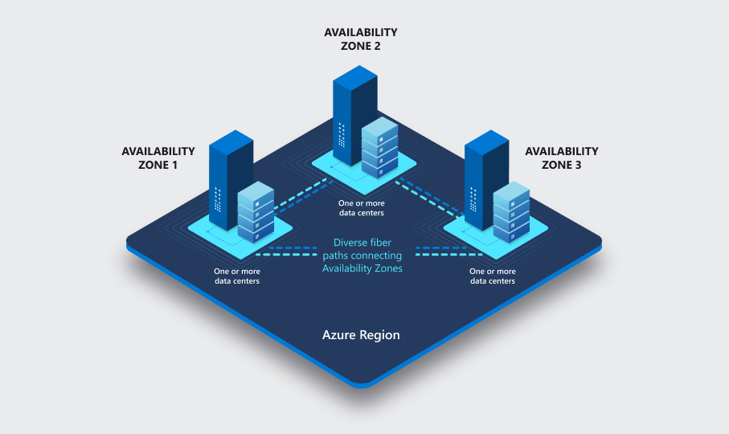
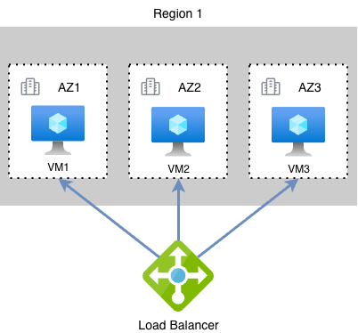
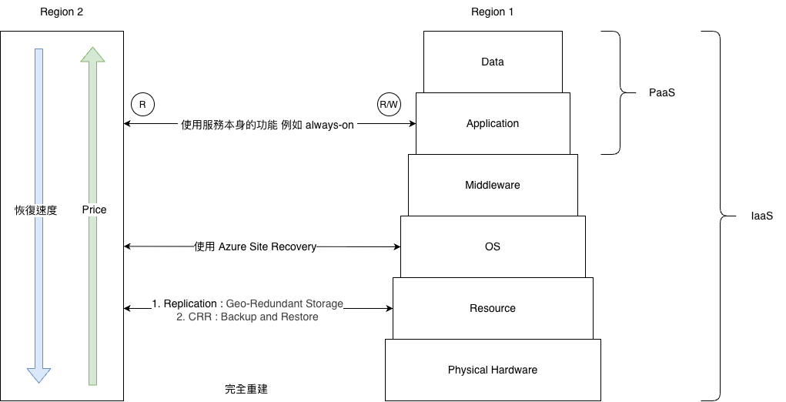
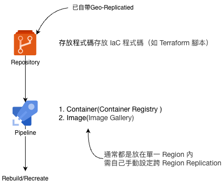
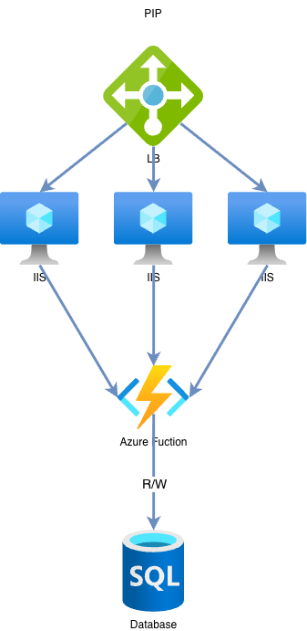

+++
title = "簡談 BCDR 雲端上的災難復原"
date = 2026-10-19T09:00:00+08:00
tags = ["bcdr", "azure"]
cover = "cover.jpg"
summary = "災難復原與業務持續的基礎觀念：RTO、RPO 與常見策略"
+++

# Introduction

最近因為工作的關係，接觸到了 BCDR 的設計與建置，便順手研究了一下這部分的知識與概念。由於接觸到的案子是以 Azure 平台為主，文章中會多以 Azure 的產品與雲端環境來舉例，不過各家雲服務商背後的概念其實是相通的，差異不大。

首先我們需要先有個觀念，雲端機房本質上跟本地機房一樣，雲端供應商只是負責託管，並不存在什麼魔法可以讓你的系統節點自動復活，也就是說今天系統部署上雲之後不代表就萬事大吉，服務永遠不當機，若需要做到高可用性與災害復原，依舊需要架構設計。

# Regions and Availability Zones

在 Azure 中

一個 Region 底下至少會劃分出 3 個可用性區域（Availability Zone, AZ）；

一個 AZ 又至少包含一個或多個資料中心（Datacenter, DC）；

一個 DC 各自擁有獨立的電源、空調與線路。

而同一個 Region 內，同 Region 的 AZ 之間的延遲必須小於 2 ms。

> Microsoft strives to achieve an inter-zone communication with round-trip latency of less than approximately 2 milliseconds.
>
> <cite>— [What are availability zones?](https://learn.microsoft.com/en-us/azure/reliability/availability-zones-overview?tabs=azure-cli%2Call#inter-zone-networking)</cite>

Region 與 Region 可能相距幾百公里遠並且存在著配對關係，我們稱之為 **region pair**，Azure 會為每個 Region 預先指定好配對區域，配對區域之間的網路連線較快，配對的區域通常是災害復原的首選區域。

雲端供應商對機房做底層更新時，不會同時更新一組配對區域：例如更新香港時，新加坡不會更新，反之亦然，所以如果主區域選香港，輔助區域通常會優先選它的配對區域新加坡。

# Recovery Metrics

在提到災害復原的時候，必定會常常聽到或提到 **RPO** 與 **RTO** 這兩個指標，這邊簡單介紹一下：

**RPO (Recovery Point Objective)**

定義你能接受丟失多少資料（例如 5 分鐘、1 小時或 1 天份的資料），RPO 越短代表能容忍的資料遺失越少，但技術成本也越高，可能需要投入大量成本才能做到分鐘級的 RPO。實務上要在 **「資料遺失容忍度」跟「成本」** 之間取捨，找出合理的 RPO 目標，當 RPO 設得越低，代表需要越頻繁的增量備份或持續複寫，維運與資料一致性校驗的成本也越高，所以不會無上限地把 RPO 往低設，因為要將資料補齊其實是一件困難的事情。

**RTO (Recovery Time Objective)**

定義系統發生問題後，需要多久才能恢復到正常運作，例如 30 分鐘、4 小時或 3 天，RTO 會依系統重要性而不同，對外的線上銷售網站可能只能容忍停機幾分鐘，RTO 就要訂得很短；公司內部系統停擺一兩天影響不大，RTO 就可以拉長。需針對每個系統個別評估合理的 RTO，而不是套用同一套標準到所有系統上，RTO 是從**系統實際發生故障的那一刻**開始起算，不是從被通報或發現問題的那一刻開始。

# High Availability

因為很多人會搞混，這邊提一下，**高可用性**（High Availability, HA）的概念並不算 Disaster Recovery，**HA 只在同一個 Region 內運作**，可以透過 Availability Zone 或 Availability Set 等手段提高系統服務的可用度。

**Active-Active Architecture**

部署在支援 Availability Zone 的服務時，可以選擇把 VM 部署在 AZ1、AZ2 或 AZ3，在三個 AZ 各放一台 VM（VM1、VM2、VM3），前面架一個 Load Balancer 做負載平衡，寫入操作可能先打到其中一台 VM，但因同區域延遲低，很快就能透過 Synchronized Replication 同步到其他 AZ 的 VM，三台都是 Active 狀態，稱為 Active-Active 架構。

# Disaster Recovery

## Definition

所謂災害通常是大型天災，例如洪水、土石流、地震等影響到整個城市或區域，這時才需要把服務切到另一個城市對外運作。

Disaster Recovery 指的是跨 Region 的災害復原，實務上真正觸發 DR 的機率很低，可能十幾二十年才發生一次，所以實務上會希望把 DR 相關成本壓到最低。

## Global Services

並不是所有 Azure 服務都需要規劃災害復原，有些服務屬於 Global 服務：本身就已經在全球多個資料中心與邊緣節點上佈了多個實例，DR 由雲端供應商處理，使用者不需要自行管理：
- **Microsoft Entra ID**：全球性的身分識別服務，不綁定在特定 Region
- **CDN**：內容分散快取在全球各地的邊緣節點
- **Azure Front Door**：應用層的全球負載平衡器，用來分流不同地區的網路流量
- **Traffic Manager**：基於 DNS 的負載平衡器，依使用者來源位置導向離他最近的伺服器

Global 服務依舊只是整體服務中的一小部分，大部分應用與資源還是部署在某個特定 Region 內，DR 仍然需要自己負責設計。

> Cross Region Replication
> 
> 提供多數 Azure 服務基於配對區域之複寫能力，進行災害復原保護，譬如 Azure 異地備援儲存體 (GRS) 會自動將資料複寫到次要區域，確保主要區域無法復原時，次要區域資料依然活著

## Recovery Strategies

| 策略 | 說明 | 速度與成本 |
| --- | --- | --- |
| **重新創建（Rebuild）** | Region 1 整個壞掉後，直接在 Region 2 重新建立資源（例如透過 IaC 範本），不依賴任何備份資料 | 速度最慢、人力介入最多 |
| **備份＋恢復（Backup and Restore）** | 平常就在 Region 1 做定期備份，並把備份資料轉移到 Region 2；當 Region 1 壞掉時，在 Region 2 重新建立資源後，再用備份資料還原。 | 速度與成本居中 |
| **複製＋同步（Replication）** | Region 2 隨時透過複寫機制跟 Region 1 保持資料同步，一旦 Region 1 壞掉，幾乎可以馬上切換到 Region 2 對外服務，可依層級有不同的做法 | 速度最快但成本也最高 |

1. **Rebuild**
  
    優先順序較低或敏感度不高的應用，用 Recreate/Rebuild 重新建立即可，可以使用 Infrastructure as Code (IaC)（例如 Azure ARM Template 或 Terraform）建立資源，避免使用手動操作，需要花時間建立資源，RTO/RPO 會相應拉長。

    

2. **Backup and Restore**

    平常針對 Region 1 的資源做定期備份，並把備份資料另外保存一份到 Region 2（例如透過 Azure Backup 的異地備援 Vault）；當 Region 1 整個故障時，先在 Region 2 重新建立資源，再用備份資料還原回去。比起 Rebuild 不用從零準備資料，但仍然要等備份還原完成，RTO/RPO 會介於 Rebuild 與 Replication 之間，是速度與成本的折衷做法。

3. **Replication**

    在不同的層級上可以有不一樣的做法
    - **Application Layer**： 由應用程式自己做複寫，例如 SQL Server Always On
    - **OS Layer**： 安裝同步代理程式（Agent）偵測變化並複寫到另一個區域，例如 Azure Site Recovery (ASR)
    - **Platform / Resource Layer**： 由 Azure 資源本身內建持續複寫能力，例如 Storage Account 可選擇 Replication 類型：LRS（複寫到同區域內的另一個機房）或 GRS（複寫到數百公里外的另一個區域）

## Standby Cost

看到這裡你可能會想：那我乾脆先把資源建好放著，反正沒流量應該不會計費吧？答案是：看資源而定。

常見 Azure 資源大致可以分成兩類：

**佈建即計費，閒置也要收錢**
- Virtual Machine（只有 Deallocate 才會停止計費，Stopped 不算）
- Managed Disk
- Azure NetApp Files（容量池最低要開 1 TiB）
- SQL Database（DTU/vCore，非 Serverless）
- App Service Plan
- Load Balancer (Standard) / Application Gateway (WAF)
- Key Vault Premium（HSM Key，每把每月固定費）

**用量計費，閒置幾乎免費**
- Blob Storage（照儲存容量計費，很適合放備份）
- Key Vault Standard（純照操作次數計費）
- Azure Functions（Consumption Plan，沒觸發就是 $0）
- Traffic Manager（照 DNS 查詢次數計費）

> 所以如果想採用「先建好待命」的策略，記得把這些閒置成本算進去；就像前面提到的，這終究是成本與復原速度之間的取捨。

## Architecture Design

實務上一個應用通常不是只有單一層，而是由多個層級組成，各層扮演的角色跟是否保有狀態（Stateless / Stateful）都不一樣，所以規劃 DR 策略時不應該整套應用套用同一種策略，而是要分層考量，才能把整體成本壓低。以下面這個簡化範例來說：

- **Stateless 元件（Load Balancer、IIS、Azure Function）**
    - 預設策略：**Recreate**，壞掉直接重建即可，對應前面 Recovery Strategies 的策略 1，不需要額外投資複寫
    - 若元件重要性較高（例如 IIS 是用 VM 架設），也可以升級用 **ASR（OS Layer Replication）** 加強保護
- **Stateful 元件（Database）**
    - 預設策略：**Replication**，優先採用服務原生複寫方案（例如 SQL Always On），把 RPO/RTO 設到最嚴格，對應策略 3，速度最快、成本也最高
    - 若資料重要性較低（例如員工餐卡打卡系統），也可以降級用 **Backup and Restore**，接受較寬鬆的 RPO/RTO 換取較低成本

> 核心原則是：策略選擇要看**元件重要性**，而不是 Stateless 只能 Recreate、Stateful 只能 Replication 這種絕對二分。

# Traffic Redirection

在完成你的災害復原策略選擇之後，該如何繼續對外提供服務，將現有的服務指向災害復原後的資源。

- **Public IP**

  最簡單但強烈不建議的做法，直接把應用暴露在公網 IP 上非常不安全；而且在 Region 1 壞掉後，Region 2 復原起來的資源會拿到一個新的公網 IP，一般狀況下沒辦法讓所有使用者馬上改連到新 IP 提供的服務。

- **DNS** 

  用同一個網域名稱，依狀況指向不同的 IP，兩個潛在問題：
  - **DNS Cache / TTL（Time to Live）**： 
  
    客戶端會把解析結果快取一段時間（例如 1 小時），不會每次連線都重新查詢；如果在 TTL 到期前主站點就壞了，客戶端在快取過期前還是會持續連到舊的、已失效的 IP。
  
  - **可能會一次回傳多筆 IP**： 
  
    DNS 伺服器可以一次回傳多筆 IP 給客戶端，由客戶端自己逐一嘗試連線，直到連上為止；Active Directory 查詢網域控制站時就是用這種方式回應。

- **Geo-distributed Load Balancer（GEO-LB）**

  跨區域的負載平衡器，依流量協定分兩種：
  - **Traffic Manager**： 基於 DNS 的負載平衡器，適合非 HTTP/HTTPS 的流量
  - **Azure Front Door**： 適合 HTTP/HTTPS 流量

# Automation

雖然 DR 發生的機率很低，但一旦真的發生，影響往往非常大。事到臨頭不可能靠人工拿著文件一步步手動 Failover，所以能自動化的步驟都應該盡量自動化。

以 Azure 為例，若使用 ASR，可以透過 **Recovery Plan** 達成自動化：針對一套應用裡不同層（例如 Database 層、Application 層、Web 層）設定啟動順序，避免所有資源同時啟動，也能在每一層啟動前、啟動後插入自訂指令碼（Script），進一步客製化復原流程。

> - [Create and customize recovery plans in Azure Site Recovery](https://learn.microsoft.com/en-us/azure/site-recovery/recovery-plan-overview)
> - [Create a recovery plan in Azure Site Recovery](https://learn.microsoft.com/en-us/azure/site-recovery/site-recovery-create-recovery-plans)

# Summary

這篇整理了不少 Azure 上跟 BCDR 相關的概念，從 Region/AZ/DC 的階層、RPO/RTO 指標、常見的復原策略，到分層的架構設計跟流量導向。實際動手規劃時，可以照著這個思路走：

1. **先定義好應用程式的 RPO/RTO 目標**：
   
   這是所有後續決策的起點，沒有先訂出能接受的資料遺失量與停機時間，後面的策略選擇就沒有依據
2. **搞懂整套架構由哪些元件組成**：
   
   盤點清楚應用程式裡有哪些 Web、運算、資料等元件，才能針對各元件分別規劃，而不是整套系統套用同一種策略
3. **找出哪個元件存了 State，針對它做最嚴格的保護**：
   
   大部分元件是 Stateless，故障直接 Rebuild 即可；只有真正存了狀態的元件（通常是資料庫）才需要投入最多成本，RPO/RTO 盡可能壓低，優先採用服務原生的 Replication

BCDR 說穿了就是不斷在**成本**跟**復原速度／資料完整性**之間取捨，與其每個元件都砸重本做 Replication，不如先認清哪些元件真的重要、哪些壞了可以直接重建，把資源花在刀口上。
